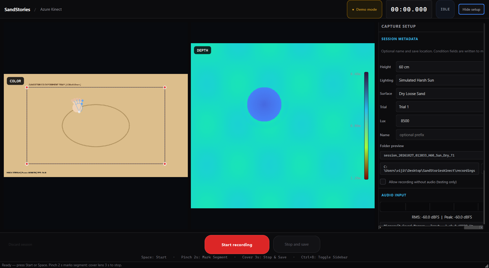
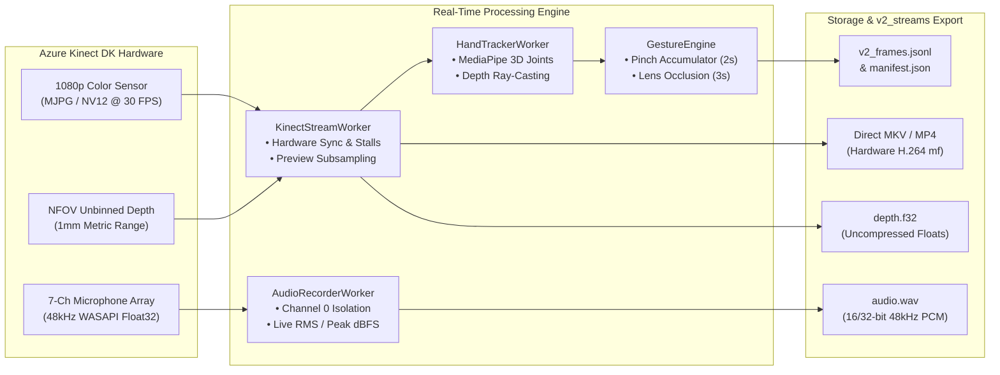
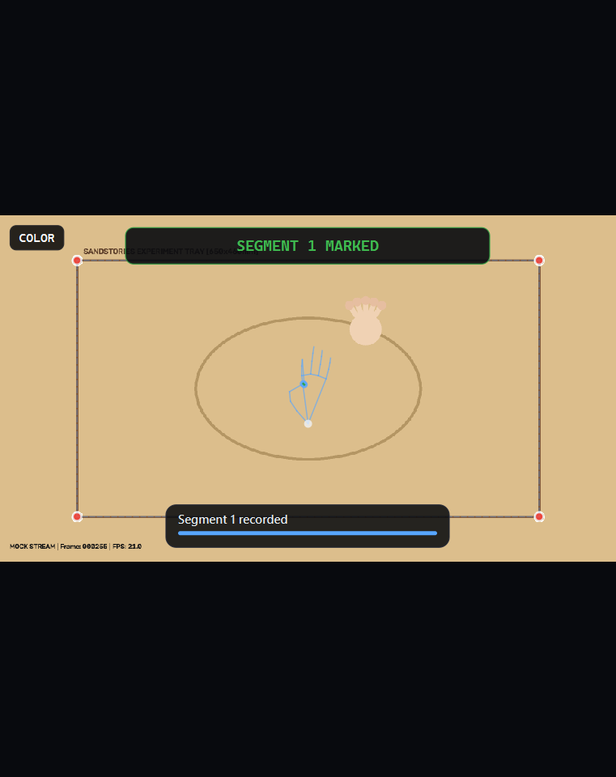
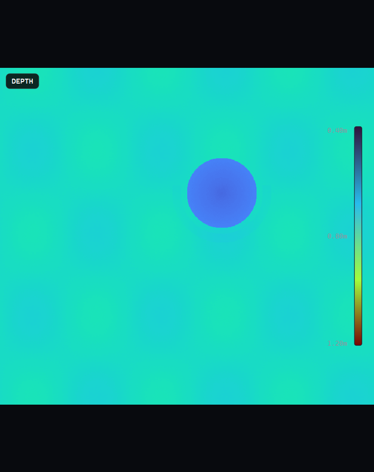
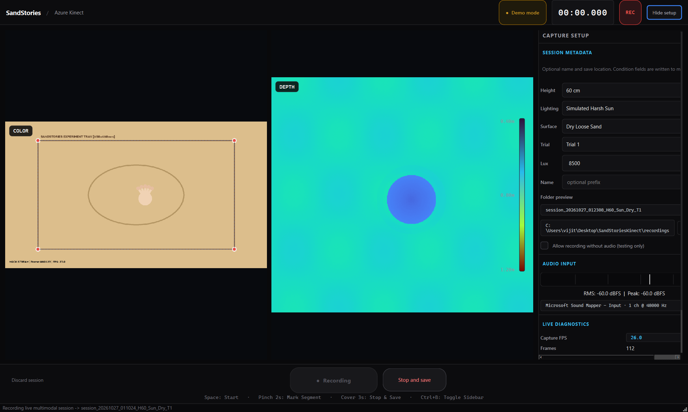
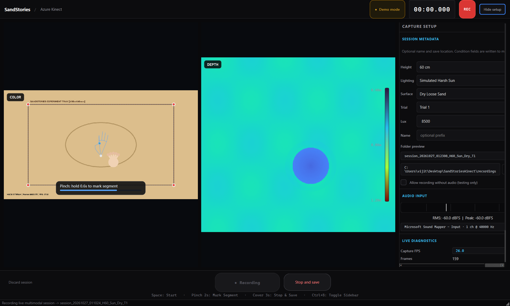
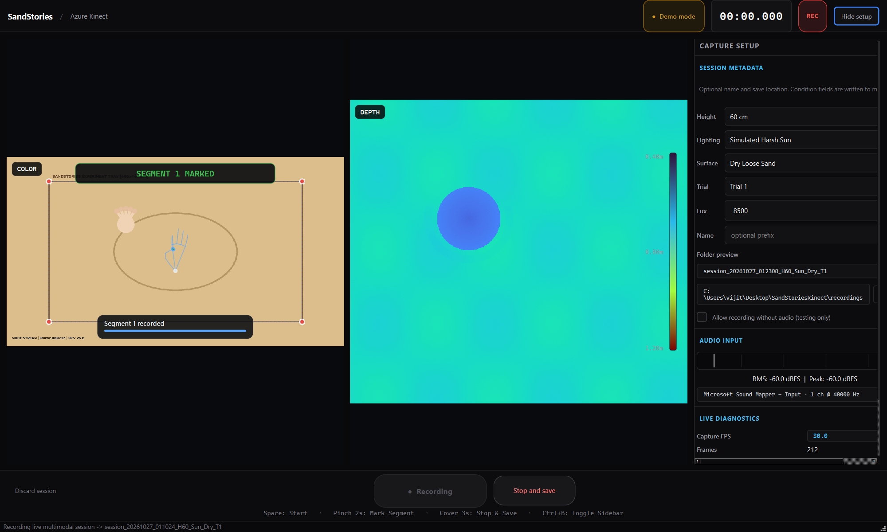

# SandStories — Azure Kinect Multimodal Capture Dashboard

[](https://www.python.org/)
[](https://microsoft.com)
[](https://azure.microsoft.com/en-us/services/kinect-dk/)
[](https://riverbankcomputing.com/software/pyqt/)
[](https://developers.google.com/mediapipe)
[](tests/)

A native Windows high-performance multimodal data acquisition workstation for the **SandStories** research project. Synchronizes 1080p RGB video, metric NFOV depth mapping, 7-channel circular microphone array audio, and 3D hand skeletal tracking into the standardized `v2_streams` format.

---

## 📸 Dashboard Overview


*High-resolution live dashboard featuring synchronized RGB and Depth viewports, SandStories experiment arena fiducials, real-time VU meter, and experimental session metadata controls.*

---

## ⚡ Multimodal Ingestion Pipeline



---

## 🌟 Visual Feature Tour

### 1. Synchronized Dual Viewfinders & Arena Calibration

The dashboard provides simultaneous side-by-side viewports rendering the live RGB and depth fields:

| 1080p Color Viewport | Aligned Metric Depth Viewport |
| :---: | :---: |
|  |  |
| **Color Field**: Displays 1080p preview with overlaid SandStories experiment sand arena boundary rectangle ($650 \times 460\,\text{mm}$) and corner fiducials. | **Metric Depth Field**: Live jet/turbo colormapped depth stream with calibrated metric distance range legend ($0.40\,\text{m}$ to $1.20\,\text{m}$). |

---

### 2. Live Recording Mode & Telemetry

When recording starts, the dashboard enters active recording mode:



* **Master Monotonic Clock**: Hardware-synchronized recording timer (`00:18.420`) driven by the session writer clock.
* **Flashing Status Beacon**: Pulsing high-contrast `REC` badge indicating continuous, un-dropped capture.
* **Real-time Diagnostics**: Frame delivery counter, dropped-frame monitoring, and hardware camera framerate verification.
* **Audio Telemetry**: Dynamic audio meter displaying real-time RMS dBFS and Peak dBFS across the 7-channel array.

---

### 3. Touchless Hand Tracking & Gesture Control

Experimenters can control recordings and annotate study segments hands-free without touching the keyboard or mouse:

| Gesture Accumulation (Pinch) | Segment Confirmation Banner |
| :---: | :---: |
|  |  |
| **MediaPipe 3D Skeletal Tracking**: Tracks 21 finger and palm joints in 3D camera space. Dynamic progress capsule (`Pinch: hold 0.6s to mark segment`) shows hold time progress bar. | **Immediate Visual Confirmation**: High-visibility green feedback capsule (`SEGMENT 1 MARKED`) confirming the event has been written to the frame timeline. |

#### Gesture Command Reference

| Gesture | Detection Criteria | Action | UI Feedback |
| :--- | :--- | :--- | :--- |
| **Pinch Hold** | Index-thumb distance $< 25\,\text{mm}$ held for **$2.0\,\text{s}$** | **Mark Segment** | Dynamic progress capsule $\rightarrow$ Green `SEGMENT [N] MARKED` banner |
| **Lens Occlusion** | Near-field depth occlusion held for **$3.0\,\text{s}$** | **Stop & Save** | Red countdown ring $\rightarrow$ Session finalized to disk |
| **Raised Palm** | Flat open hand raised facing sensor for **$1.5\,\text{s}$** | **Pause / Resume** | Amber `PAUSED` pill toggle |

---

## 📂 Standardized `v2_streams` Session Format

Recordings match the exact storage format used by the SandStories ecosystem:

```text
AzureKinectRecordings/
└── session_20261027_011024_H60_Sun_Dry_T1/
    ├── manifest.json            # Session parameters, hardware calibration, intrinsics
    ├── conditions.json          # Experiment condition tags (height, lighting, sand surface, lux)
    ├── rgb.mp4                  # 1080p color video stream (H.264 MediaFoundation encoded)
    ├── depth.f32                # Uncompressed float32 per-pixel metric depth frames (meters)
    ├── audio.wav                # High-fidelity 48,000 Hz WAV audio recording
    ├── v2_frames.jsonl          # Per-frame monotonic timestamps, gesture states & 3D hand joints
    ├── strokes.json             # Annotated interaction strokes & segmented event timestamps
    └── raw_capture.mkv          # Direct hardware MKV backup container
```

---

## 🛠️ System Requirements

* **Operating System**: Windows 10 or Windows 11 (64-bit)
* **Python Runtime**: Python 3.12 (`py -3.12`)
* **Sensor SDK**: [Azure Kinect Sensor SDK v1.4.2](https://github.com/microsoft/Azure-Kinect-Sensor-SDK) (installed at `C:\Program Files\Azure Kinect SDK v1.4.2`)
* **GPU**: NVIDIA or Intel GPU with hardware MediaFoundation H.264 encoder support (`h264_mf`)
* **Ports**: Dedicated USB 3.0 / 3.1 Gen 1 port for Azure Kinect DK

---

## 🚀 Quick Start

### 1. Launch with Physical Hardware

Ensure the Azure Kinect DK is connected to a USB 3.0 port and power adapter:

```powershell
# From the repository directory:
py -3.12 run_dashboard.py

# Or launch via the Desktop launcher:
C:\Users\vijit\Desktop\Kinect_Dashboard.bat
```

### 2. Synthetic Test Mode (No Hardware Needed)

Launch the dashboard in simulated demo mode to test user interface, hand tracking, and storage routines without plugging in the physical sensor:

```powershell
py -3.12 run_dashboard.py --mock
```

---

## 🧪 Automated Testing

The repository contains an automated test suite verifying capture pipelines, audio buffers, hand projection, and gesture state transitions:

```powershell
py -3.12 -m pytest tests -v
```

```text
============================= test session starts =============================
platform win32 -- Python 3.12.10, pytest-9.1.1, pluggy-1.6.0
collected 20 items

tests/test_kinect_dashboard.py::test_mock_kinect_stream_generation PASSED           [  5%]
tests/test_kinect_dashboard.py::test_audio_recorder_worker_and_rms PASSED          [ 10%]
tests/test_kinect_dashboard.py::test_hardware_stream_does_not_fall_back_to_mock PASSED [ 15%]
tests/test_kinect_dashboard.py::test_stale_lifetime_frame_count_does_not_enable_recording PASSED [ 20%]
tests/test_kinect_dashboard.py::test_invalid_mjpg_preview_frame_does_not_kill_capture PASSED [ 25%]
tests/test_kinect_dashboard.py::test_repeated_capture_errors_stop_worker PASSED    [ 30%]
tests/test_kinect_dashboard.py::test_audio_requires_explicit_synthetic_mode PASSED [ 35%]
tests/test_kinect_dashboard.py::test_missing_aligned_depth_is_not_fabricated PASSED [ 40%]
tests/test_kinect_dashboard.py::test_hand_tracker_3d_projection_and_velocity PASSED [ 45%]
tests/test_kinect_dashboard.py::test_gesture_state_machine_transitions PASSED      [ 50%]
tests/test_kinect_dashboard.py::test_unified_gestures_priority_and_hysteresis PASSED [ 55%]
tests/test_kinect_dashboard.py::test_pinch_marks_segment_while_hand_moves PASSED   [ 60%]
tests/test_kinect_dashboard.py::test_frozen_tracking_frame_cannot_complete_hold PASSED [ 65%]
tests/test_kinect_dashboard.py::test_tracking_loss_does_not_rearm_pinch PASSED     [ 70%]
tests/test_kinect_dashboard.py::test_pinch_classification_uses_2d_ratio_with_hysteresis PASSED [ 75%]
tests/test_kinect_dashboard.py::test_session_name_prefixes_folder_and_is_sanitized PASSED [ 80%]
tests/test_kinect_dashboard.py::test_kinect_audio_uses_channel_zero_not_average PASSED [ 85%]
tests/test_kinect_dashboard.py::test_session_writer_video_writes_one_frame_per_capture PASSED [ 90%]
tests/test_kinect_dashboard.py::test_session_writer_fair_export PASSED             [ 95%]
tests/test_kinect_dashboard.py::test_raw_mkv_session_outputs_audio_metadata_and_gestures PASSED [100%]

============================= 20 passed in 21.29s =============================
```

---

## 📁 Repository Structure

```text
SandStoriesKinect/
├── kinect_dashboard/
│   ├── core/
│   │   ├── kinect_stream.py      # PyK4A capture, device locking, stall protection
│   │   ├── audio_recorder.py     # WASAPI 48kHz audio array acquisition
│   │   ├── hand_tracker.py       # MediaPipe Hands 3D joint projection & raycasting
│   │   └── gesture_engine.py     # Pinch, cover, and palm gesture state machine
│   ├── storage/
│   │   ├── session_writer.py     # Standardized v2_streams session exporter
│   │   └── raw_mkv_session.py    # Direct MKV streaming container
│   ├── ui/
│   │   ├── main_window.py        # PyQt6 main interface & master synchronization
│   │   ├── viewports.py          # RGB and Depth OpenGL/Qt rendering widgets
│   │   ├── vu_meter.py           # Audio channel dB level visualizer
│   │   └── styles.py             # Polished dark theme styling
│   ├── main.py                   # CLI entry point and argument parsing
│   └── requirements.txt          # Python dependencies
├── tests/
│   └── test_kinect_dashboard.py  # 20 automated integration and unit tests
├── docs/
│   ├── screenshots/              # High-resolution dashboard snapshots
│   └── generate_screenshots.py   # Snapshot capture automation script
├── launch_dashboard.bat          # Batch launcher
├── run_dashboard.py              # Root launcher script
└── README.md                     # Pictorial documentation
```

---

## Contact

For questions about this software or the SandStories research, contact
Vijit Vijay Pugalia at [VijitPugalia@gmail.com](mailto:VijitPugalia@gmail.com).

---

## 📜 License & Research Attribution

This software is developed for the **SandStories** research initiative. All rights reserved.
For research collaboration and citation details, refer to the project documentation.
